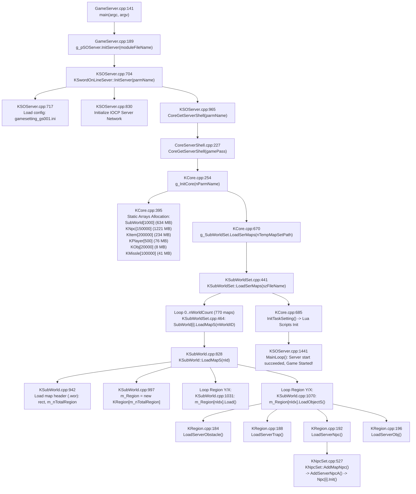

# JX1 Server Architecture Audit & Startup Call Graph

## 1. Tổng quan môi trường & Nền tảng
- **Hệ điều hành:** Windows Server / Windows 10/11 x64.
- **Compiler/Toolchain:** Microsoft Visual Studio 2022 BuildTools (v143, x64).
- **Target Configuration:** `Server Release|x64`, DLL output: `CoreServer.dll` (12.15 MB), EXE: `gs001.exe`.
- **GameServer process model:** Đơn tiến trình (`gs001.exe`) nạp toàn bộ thế giới trò chơi (770 map).
- **Cơ chế nạp gốc:** Monolithic eager loading (nạp toàn bộ 770 map, obstacle, trap, và 74.290 NPC ngay khi boot).

---

## 2. Chi tiết Startup Call Graph (Đường dẫn file:dòng chính xác)

---

## 3. Phân biệt Dữ liệu Tĩnh (Cold Definitions) và Dữ liệu Động (Hot Runtime)

### 3.1 Dữ liệu Bản đồ
* **Bản đồ tĩnh (Cold Definitions):**
  - Tên map, ID, kích thước rect (BeginX, BeginY, EndX, EndY), số region (`m_nTotalRegion`), tỷ lệ rơi đồ, thiết lập PK punish state.
  - Obstacle map data: 2.048 bytes per region (`m_Obstacle[16][32]`).
  - Trap points: ID bẫy và vị trí cell chuyển cảnh.
* **Bản đồ runtime (Hot Runtime):**
  - `m_cActRegionIdx`: Danh sách các region đang active có người chơi.
  - Vòng lặp `KSubWorld::Activate()`: Xử lý quái, va chạm, missile theo từng frame.

### 3.2 Dữ liệu NPC
* **NPC tĩnh (Spawn Definitions):**
  - Template ID, Level, vị trí tọa độ gốc $(X, Y)$, Tên hiển thị, Ngũ hành, Loại quái (`shKind`), Đường dẫn script Lua gắn liền (`szScript`), Tỷ lệ rơi đồ (`nNDropFile`, `nGDropFile`).
* **NPC runtime (Hot Instance State):**
  - `KNpc[i]` instance: Máu hiện tại (`m_CurrentLife`), Nội lực, Mana, Trạng thái chiến đấu, Trạng thái đóng băng/trúng độc, Vị trí di chuyển hiện tại, Điểm đích (`m_DesX, m_DesY`), AI state machine, Danh sách hận thù (Aggro table).

---

## 4. Các yếu tố phụ thuộc kiến trúc 64-bit (x64)

1. **Kích thước con trỏ (Pointer Size):**
   - Trên x86 (32-bit Linux V9): `sizeof(void*) = 4` bytes.
   - Trên x64 (Windows CoreServer): `sizeof(void*) = 8` bytes.
   - Hệ quả: Mọi vtable, con trỏ mảng, linked list node (`KList`, `KIndexNode`, `KNode`), `KRegion* m_pConRegion[8]` đều tăng gấp đôi kích thước.
2. **Căn lề bộ nhớ (Struct Alignment & Padding):**
   - MSVC x64 mặc định align các thành viên 8-byte theo biên 8-byte.
   - Các struct chứa hỗn hợp `int` (4 bytes) và con trỏ (8 bytes) bị chèn padding 4 bytes vào giữa.
3. **Mảng toàn cục tĩnh (Static Preallocated Pools):**
   - `KNpc[150000]`: `8536 bytes * 150000 = 1221 MB` (trên x86 chỉ ~600 MB).
   - `SubWorld[1000]`: `sizeof(KSubWorld) ~ 634 KB * 1000 = 634 MB` (trên x86 chỉ ~280 MB).
   - `KItem[200000]`: `1232 bytes * 200000 = 234 MB` (trên x86 chỉ ~120 MB).
   - `KPlayer[500]`: `160824 bytes * 500 = 76 MB`.
   - `KMissle[100000]`: `432 bytes * 100000 = 41 MB`.
   - `KObj[20000]`: `420 bytes * 20000 = 8 MB`.
   - **Tổng mảng tĩnh toàn cục: ~2.214 MB (2.21 GB).**
