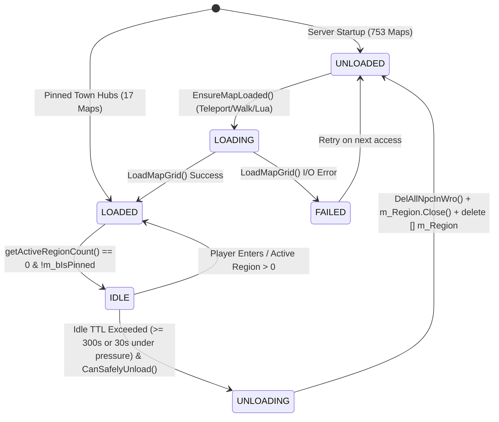

# RFC: World & NPC Dynamic Streaming Architecture for JX1 C++ 64-Bit

## 1. Summary
This RFC formalizes the architecture for on-demand lazy map loading, region streaming, dynamic NPC activation, and safe map unloading on the 64-bit Windows JX1 GameServer (`gs001.exe`). It reduces server startup memory footprint from ~11.82 GB to 4.56 GB while guaranteeing 100% gameplay, script, and client-protocol preservation.

---

## 2. State Machine & Map Lifecycle

---

## 3. Invariants & Ownership Guarantees

1. **Registry Invariant:**
   - The map registry retains all 770 maps with valid `m_SubWorldID`, dimensions, and metadata loaded eagerly in Tier 1 (`LoadMapMetadata()`).
   - `g_SubWorldSet.SearchWorld(dwMapId)` always resolves correctly regardless of load state.
2. **Single-Flight Concurrency Guard:**
   - Map loading is protected by `m_eMapState == emMAP_STATE_LOADING` to prevent recursive re-entry.
   - Synchronous load operations per tick are bounded by `MaxConcurrentLoads` (default 2).
3. **Safe Unload Guardrails (`CanSafelyUnload`):**
   - A map CANNOT be unloaded if:
     1. `m_bIsPinned == TRUE` (Towns, capitals, starter villages).
     2. Any active player exists on this `m_SubWorldIndex`.
     3. Active region count `getActiveRegionCount() > 0`.
     4. Any battle/tournament mission is running (`m_MissionArray.GetUsedCount() > 0`).
     5. The map state is not `emMAP_STATE_LOADED`.
4. **Zero Dangling Pointers:**
   - Before `m_Region` array deallocation, all spawned NPCs are recycled via `DelAllNpcInWro()`.
   - All runtime monster indices in `KSpawnDefinition` are reset to 0.

---

## 4. NPC Streaming & Exception Matrix

| Entity Category | Lifecycle Policy | Storage / Location |
| :--- | :--- | :--- |
| **Town NPCs / Shopkeepers** | Permanently Pinned | Resident in `Npc[]` pool |
| **Quest Givers / Hub NPCs** | Permanently Pinned | Resident in `Npc[]` pool |
| **World Bosses / Special** | Permanently Pinned | Resident in `Npc[]` pool |
| **Lua Dynamic NPCs** | Permanently Pinned (`m_bDynamicAdd`) | Resident in `Npc[]` pool |
| **Regular Field Monsters** | Dynamic Region Streamed | Cold `KSpawnDefinition` in `KRegion::m_vSpawnDefs` |

- **Activation Trigger:** Player presence within region or 8 adjacent neighbors (1-ring AOI).
- **State Persistence:** Preserves `bIsDead`, `nCurLife`, and `dwNextRespawnTick` across dormant/active cycles.
